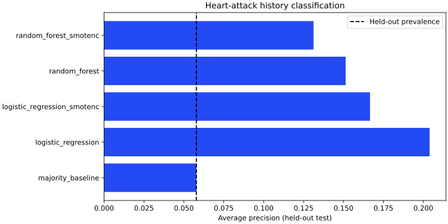

# Heart Attack Classification

Leakage-controlled classification of self-reported heart-attack history in health-survey data.

## Data and scope

The supplied 10,000-row survey sample is included with explicit user authorization. Source-system identifiers are not present. Do not treat the measurements as prospective clinical outcomes.

## Run

```bash
python -m venv .venv
source .venv/bin/activate
python -m pip install -r requirements.txt
python src/analysis.py
python -m unittest discover -s tests -v
```

Outputs are written to `outputs/`. The clean notebook in `notebooks/analysis.ipynb` calls the same tested module. See `docs/provenance.md` for changes from the source notebook and `docs/validation.md` for actual execution results.

## Measured results

Corrected pipeline, supplied sample, fixed stratified 70/30 split. Unknown outcome labels are excluded. The positive test prevalence is **5.79%**. These are retrospective self-report classifications, not future-risk estimates.

| Model | ROC-AUC | Average precision | Precision | Recall | Training CV average precision |
| --- | ---: | ---: | ---: | ---: | ---: |
| majority_baseline | 0.5000 | 0.0579 | 0.0000 | 0.0000 | 0.0000 |
| logistic_regression | 0.8004 | 0.2040 | 0.0000 | 0.0000 | 0.2056 |
| logistic_regression_smotenc | 0.7506 | 0.1666 | 0.1357 | 0.5174 | 0.1712 |
| random_forest | 0.7487 | 0.1513 | 0.0000 | 0.0000 | 0.1874 |
| random_forest_smotenc | 0.7437 | 0.1313 | 0.1626 | 0.1919 | 0.1475 |

The unresampled logistic model has the strongest training CV average precision among these candidates, but at the default 0.5 threshold it predicts no positive test cases. Oversampling raises recall while producing many false positives. No deployable clinical model is claimed. Three-fold training CV is separate from the untouched test split; no test-driven threshold optimization was performed. Full confusion matrices are in `docs/metrics.json`.


